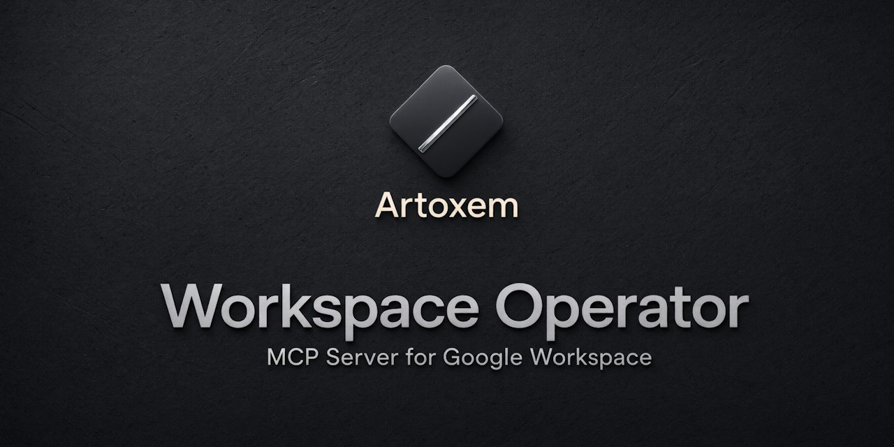
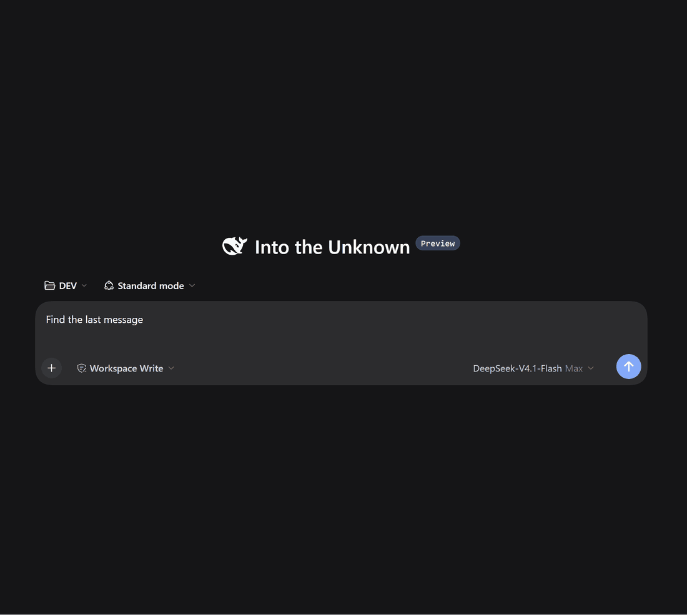
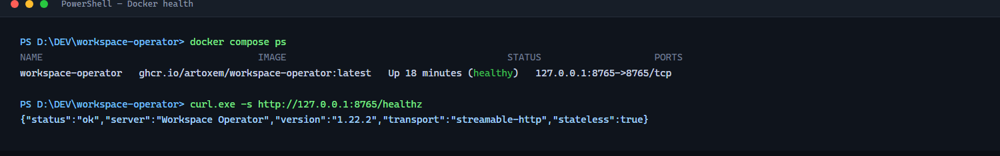

<div align="center">

# Workspace Operator

**Глубокая автоматизация Google Workspace через Model Context Protocol**

Drive · Docs · Sheets · Gmail · Calendar · Tasks · Forms · Apps Script — один
локальный MCP-сервер с 39 инструментами, многошаговыми записями и профилями на стороне сервера.

[](https://www.python.org/)
[](https://modelcontextprotocol.io)
[](#-каталог-инструментов)
[](https://pypi.org/project/workspace-operator-mcp/)
[](antigravity/README.md)
[](LICENSE)

[English](README.md) · [Русский](README.ru.md)

</div>

---



Workspace Operator работает на вашей машине,
обращается к Google через ваш собственный OAuth-клиент и даёт ИИ-агенту операции,
которые превращают «прочитай мою почту» в «сделай работу, и чтобы можно было откатить»:
стейджинг Apps Script, передача файлов, форматирование таблиц, ответы в тред и
работа с вложениями.

**39 инструментов · 3 ресурса · 3 шаблона ресурсов · 8 промптов**, у каждого инструмента
аннотации `readOnlyHint` / `destructiveHint`.

Ничто здесь не привязано к конкретному аккаунту, таблице или документу: каждый
инструмент принимает идентификаторы и диапазоны, а примеры используют синтетические данные.



*Находит последнее письмо, читает его и перемещает в корзину. Письмо можно восстановить в течение 30 дней.*

## Сравнение

| | Google Workspace MCP (remote) | **Workspace Operator** |
|---|---|---|
| Транспорт | Streamable HTTP, хостинг Google | **stdio + Streamable HTTP, локально или Docker** |
| Доступность | Developer Preview | **публично, MIT** |
| Путь данных | эндпоинт MCP Google | **ваша машина, ваш OAuth-клиент** |
| Apps Script | — | **создание · чтение · стейджинг · запуск · отмена · откат · вызов функции** |
| Локальные файлы | — | **загрузка, скачивание, экспорт в pdf/docx/xlsx/pptx** |
| Форматирование Sheets | — | **жирный, цвета, форматы чисел, ширины, закрепление** |
| Треды Gmail | отдельные письма | **треды, вложения, ответы в тред** |
| Профили инструментов на сервере | IAM / allow-list админа | **read-only / read-write / full + allow-deny** |

Официальные серверы — правильный выбор для «спроси у почты».
Workspace Operator — для «измени рабочее пространство так, чтобы можно было откатить».

## Что внутри

| Группа | Инструментов | Ключевое |
|---|---:|---|
| 🔎 Discovery | 4 | Кросс-поиск, поиск по Drive, дайджест, сравнение таблиц |
| 📦 Массовые операции | 7 | план → подтверждение → запуск → откат для Drive, Gmail, Docs и Sheets |
| 📁 Drive | 4 | поиск, чтение, запись, обратимая корзина, права |
| 📊 Sheets | 6 | значения, форматирование, структура, данные, удаление (confirm) |
| 📄 Docs | 3 | чтение, запись, замена/формат (confirm) |
| 📧 Gmail | 4 | чтение, запись, настройки, обратимая корзина |
| 📅 Calendar | 3 | чтение, запись, удаление |
| ✅ Задачи | 2 | чтение, запись |
| 📝 Формы | 2 | чтение, запись |
| 📮 Postmaster | 1 | домены и статистика доставляемости |
| ⚙️ Apps Script | 3 | чтение, стейджинг, запуск (admin) |

Плюс 3 ресурса, 3 шаблона ресурсов и 8 промптов — см. [каталог](#-каталог-инструментов).

## Кому подходит

Workspace Operator — **однопользовательский сервер**: один процесс, один
Google-аккаунт, один профиль инструментов. «Несколько клиентов» не значит
«несколько пользователей».

| Что у вас | Подходит? | Что происходит |
|---|---|---|
| Один человек и несколько MCP-клиентов | **Да** | У каждого клиента может быть свой bearer-токен (`http_tokens`); аккаунт, профиль и данные общие |
| Небольшая команда на одном Google-аккаунте | **Работает, но без изоляции** | Все видят один Drive/Gmail; массовые задачи и аудит общие; для недоверенных людей ставьте профиль `read-only` |
| Несколько Google-аккаунтов | **Один экземпляр на аккаунт** | Отдельные конфиг, OAuth-токен, каталог данных и порт/контейнер на человека |
| Публичный сервис или multi-tenant SaaS | **Нет** | Нет аутентификации пользователей, квот, владельцев задач и разделения данных |

Bearer-токен лишь идентифицирует клиента в аудит-логе; отдельного пользователя
он не создаёт. Любой, у кого есть валидный токен, может вызвать любой
доступный инструмент и отменить любую массовую задачу этого экземпляра. Перед
тем как делить экземпляр с другими людьми, прочитайте
[SECURITY.md](docs/ru/SECURITY.md#модели-развёртывания-и-изоляция).

## Быстрый старт

### 0 — Выберите способ запуска

| Что нужно | Что использовать | Что это значит |
|---|---|---|
| Один настольный клиент (Claude Desktop, Cursor, DSH, Windsurf, Cline) | **stdio** | Клиент сам запускает сервер дочерним процессом. Нет порта и bearer-заголовка; сервер живёт, пока живёт клиент. |
| Один сервер для нескольких клиентов и агентов | **Docker / HTTP** | Постоянный контейнер на `127.0.0.1:8765`. Каждый клиент подключается по URL с bearer-токеном. |
| Хотите менять код | **исходники** | То же stdio, но установка из `requirements.txt`. |

В обоих случаях **один раз нужен Google OAuth**. Для HTTP дополнительно нужен
локальный `MCP_AUTH_TOKEN` — это не Google-учётка и не токен Google.

### 1 — Установка

**stdio (для одного настольного клиента)**

```bash
pip install workspace-operator-mcp
workspace-operator version
```

**Docker / HTTP (для нескольких клиентов)**

```bash
docker pull ghcr.io/artoxem/workspace-operator:1.22.1
```

**Из исходников (разработка)**

```bash
git clone https://github.com/Artoxem/workspace-operator.git
cd workspace-operator
python -m venv .venv && .venv\Scripts\activate    # Windows
pip install -r requirements.txt
```

Нужен Python 3.10+. Пакет ставит команду `workspace-operator`; форма
`python -m workspace_operator` тоже работает из исходников.

### 2 — Google OAuth (один раз)

1. Создайте проект в [Google Cloud Console](https://console.cloud.google.com/).
2. Включите нужные API: **Drive, Docs, Sheets, Gmail, Calendar,
   Apps Script**, а также **Tasks** и **Forms**. **Postmaster Tools** —
   необязательно и нужно только для подтверждённых доменов.
3. Настройте OAuth consent screen: **External**, добавьте свой аккаунт в
   тестовые пользователи, пока приложение в режиме Testing.
4. Создайте **OAuth client ID** типа **Desktop app**, скачайте JSON и сохраните
   его как `oauth.keys.json` в `~/.google/`.
5. Авторизуйтесь один раз:

```bash
workspace-operator doctor
```

При первом запуске откроется браузер. Войдите, разрешите доступы — токен
сохранится в `~/.google/token.json`.

**Нет браузера (сервер, SSH, Docker-хост)?** Авторизуйтесь на машине с
браузером, скопируйте `token.json` рядом с `oauth.keys.json` на целевую машину
и смонтируйте каталог в контейнер **на запись**. Сервер обновляет токен на
месте, поэтому read-only монтирование сломает обновление.

**Поменялись scopes или обновились на мажорную версию?** Удалите `token.json`
и снова запустите `workspace-operator doctor`. Doctor покажет, каких именно
scopes не хватает.

> Пошагово, с описанием экранов Google Cloud:
> [docs/ru/AUTH_SETUP.md](docs/ru/AUTH_SETUP.md) · [docs/AUTH_SETUP.md](docs/AUTH_SETUP.md)

### 3 — Конфигурация

```bash
cp config.example.yaml config.yaml
```

```yaml
client_secrets_file: "/home/you/.google/oauth.keys.json"
token_file: "/home/you/.google/token.json"
backup_dir: "/home/you/.google/backups"
mcp_auth_token: "длинная-случайная-строка"
tool_profile: "core"            # core | full | read-write | read-only
```

В Windows используйте прямые слэши (`C:/Users/you/.google/oauth.keys.json`) или
двойные обратные в YAML. Любой ключ можно переопределить переменной окружения —
см. [docs/ru/SECURITY.md](docs/ru/SECURITY.md).

Два разных секрета, не перепутайте:

| Секрет | Что это | Кто создаёт |
|---|---|---|
| `token.json` | Google OAuth токен — подтверждение, что Google выдал доступы | Google после нажатия **Allow** в браузере |
| `mcp_auth_token` | Локальная bearer-строка — ключ активации сервера и заголовок `Authorization` для HTTP | Вы, любая случайная строка |

`mcp_auth_token` сам по себе не сетевая защита: это ключ активации и bearer для
HTTP-транспорта.

### 4 — Подключение клиента

**stdio-клиент** — клиент сам запускает установленную команду:

```json
{
  "mcpServers": {
    "workspace-operator": {
      "command": "workspace-operator",
      "args": ["serve"],
      "env": {
        "MCP_CONFIG_FILE": "C:/Users/you/.google/config.yaml",
        "MCP_AUTH_TOKEN": "длинная-случайная-строка"
      }
    }
  }
}
```

**HTTP-клиент** — контейнер или `workspace-operator serve --http` уже запущены:

```json
{
  "mcpServers": {
    "workspace-operator": {
      "url": "http://127.0.0.1:8765/mcp",
      "headers": { "Authorization": "Bearer длинная-случайная-строка" }
    }
  }
}
```

Пути для конкретных клиентов: [docs/ru/IDE_SETUP.md](docs/ru/IDE_SETUP.md) ·
[docs/IDE_SETUP.md](docs/IDE_SETUP.md). Для Antigravity отдельная инструкция:
[antigravity/README.md](antigravity/README.md).

Если клиент не может запустить команду, проверьте `workspace-operator version`
в той же оболочке, из которой запускается клиент: у IDE часто другой `PATH`.

## Профили инструментов

Профиль — серверный allow-list: инструменты вне профиля не показываются и не
вызываются. Он дополняет OAuth-скоупы (что разрешает Google) и права клиента
(что агенту можно без спроса).

| Профиль | Инструментов | Для чего |
|---|---:|---|
| `core` | 20 | ежедневное чтение/запись без форматирования и destructive |
| `full` | 39 | форматирование, destructive, Forms, Postmaster, Script |
| `read-write` | 30 | автоматизация без destructive |
| `read-only` | 17 | разведка, демо, общие машины, недоверенные агенты |

```yaml
tool_profile: "core"
# Необязательно, применяется поверх профиля. Запрет важнее разрешения.
allowed_tools: ["workspace_search", "sheets_read", "read_doc", "gmail_read"]
denied_tools: ["gmail_write", "drive_write"]
```

Переменные окружения: `MCP_TOOL_PROFILE`, `MCP_ALLOWED_TOOLS`, `MCP_DENIED_TOOLS`.
Заблокированный вызов возвращает понятное объяснение, а не молчит.

См. [выбор профиля](docs/ru/PROFILES.md) и [переход на 2.0](docs/ru/MIGRATION_2.0.md).

## Эксплуатация

```bash
python -m workspace_operator doctor     # конфиг, токен, скоупы, доступность API
python -m workspace_operator doctor --offline   # то же, но без сети
python -m workspace_operator tools      # каталог (--profile read-only, --json)
python -m workspace_operator serve      # stdio-сервер
```

| Возможность | Как включить | Что делает |
|---|---|---|
| **Dry run** | `MCP_DRY_RUN=1` или `dry_run: true` | Все инструменты, кроме read-only, возвращают превью вместо выполнения — безопасные демо и разведка |
| **Аудит-лог** | `MCP_AUDIT_LOG=~/.google/audit.jsonl` | Одна JSON-строка на вызов: инструмент, профиль, статус, длительность, **имена** аргументов (без значений) |
| **Ретраи** | `MCP_RETRY_ATTEMPTS=3` | Транзиентные ошибки Google (429/5xx) повторяются с экспоненциальной паузой |
| **Doctor** | `python -m workspace_operator doctor` | Проверяет секреты, токен, скоупы и доступность API; код 1 при критичной ошибке |

В dry-run read-only инструменты продолжают работать, поэтому агент может изучать
данные, пока каждая запись превращается в явное превью.

### HTTP-транспорт (сначала localhost)

```bash
python -m workspace_operator serve --http --port 8765
```

* по умолчанию слушает `127.0.0.1` — из сети недоступен;
* каждый запрос требует `Authorization: Bearer <mcp_auth_token>`; дополнительные
  токены клиентов задаются в `http_tokens` в `config.yaml`, а аудит-лог пишет имя
  токена в поле `client`;
* включена защита от DNS-rebinding: проходят только ожидаемые `Host`, браузерные
  `Origin` отклоняются;
* `GET /healthz` не требует токена и отдаёт только версию и транспорт;
* привязка к не-loopback адресу требует **одновременно** `--allow-network` и
  `--insecure`; loopback-имена принимают любой порт (контейнеры, прокси),
  для остального нужен явный `--allow-host`;
  `--insecure`, поэтому выход в сеть всегда осознанный.

### Docker

Контейнер работает по **HTTP** и не может открыть браузер, поэтому сначала
авторизуйте Google **на хосте**:

```bash
pip install workspace-operator-mcp   # или используйте исходники
workspace-operator doctor           # браузер -> ~/.google/token.json
```

Дальше — Compose (рекомендуется) или один `docker run`.

**Compose**

```bash
cp .env.example .env                # задайте MCP_AUTH_TOKEN и GOOGLE_DIR
docker compose up -d
curl http://127.0.0.1:8765/healthz
```

`docker-compose.yml` монтирует `config.docker.yaml`, каталог Google **на запись**
и `./data` для аудит-лога и массовых задач.

**docker run — Linux/macOS**

```bash
docker run -d --name workspace-operator --restart unless-stopped \
  -p 127.0.0.1:8765:8765 \
  -v "$HOME/.google:/home/app/.google" \
  -v "$PWD/config.docker.yaml:/app/config.yaml:ro" \
  -v "$PWD/data:/home/app/data" \
  -e MCP_AUTH_TOKEN="$(python -c 'import secrets; print(secrets.token_urlsafe(32))')" \
  ghcr.io/artoxem/workspace-operator:1.22.1
```

**docker run — Windows PowerShell**

```powershell
$token = python -c "import secrets; print(secrets.token_urlsafe(32))"
docker run -d --name workspace-operator --restart unless-stopped `
  -p 127.0.0.1:8765:8765 `
  -v "${env:USERPROFILE}\.google:/home/app/.google" `
  -v "${PWD}\config.docker.yaml:/app/config.yaml:ro" `
  -v "${PWD}\data:/home/app/data" `
  -e MCP_AUTH_TOKEN=$token `
  ghcr.io/artoxem/workspace-operator:1.22.1
```

Укажите HTTP-клиенту `http://127.0.0.1:8765/mcp` и заголовок
`Authorization: Bearer <token>`. Каталог Google смонтирован на запись намеренно:
сервер обновляет `token.json` на месте.



*`docker compose ps` показывает healthy, `/healthz` возвращает запущенную версию.*

**Клиенты, которые умеют только stdio**, тоже могут использовать образ —
entrypoint принимает те же аргументы, что и CLI:

```bash
docker run -i --rm \
  -v "$HOME/.google:/home/app/.google" \
  --entrypoint python \
  ghcr.io/artoxem/workspace-operator:1.22.1 -m workspace_operator serve
```

Что-то не работает? Смотрите [docs/ru/TROUBLESHOOTING.md](docs/ru/TROUBLESHOOTING.md).

Что-то не работает? Смотрите [docs/ru/TROUBLESHOOTING.md](docs/ru/TROUBLESHOOTING.md).

## Каталог инструментов

39 consolidated tools. The default `core` profile exposes 20; `full` adds formatting, destructive edits, Forms, Postmaster and Script actions.

Call a consolidated tool with an `action`, for example `drive_read(action="metadata", file_id=...)` or `sheets_write(action="append", spreadsheet_id=..., range=..., values=...)`.

| Tool | Safety | Actions | What it does |
|---|---|---|---|
| `workspace_search` | read | - | Search Drive, Gmail and Calendar in one call. |
| `drive_search` | read | - | Search Drive with full query syntax (replaces find_files and drive_search_advanced). |
| `digest` | read | - | Summarise Gmail, Calendar and Drive for the last N hours. |
| `compare_tables` | read | - | Diff two sheet ranges by a key column. |
| `drive_read` | read | metadata, export, list_permissions | Read Drive metadata, permissions and exported files. |
| `drive_write` | write | create_folder, copy, move, rename, upload, share, restore | Create, copy, move, rename, upload, share and restore Drive files. |
| `drive_trash` | destructive | - | Move a Drive file to Trash (recoverable 30 days; no permanent delete). |
| `drive_permissions` | destructive | remove, revoke_public | Remove access from a Drive file. |
| `read_doc` | read | - | Read the contents of a Google Doc. |
| `docs_write` | write | create, append, insert_image | Create and extend Google Docs. |
| `docs_edit` | destructive | replace, format | Replace or format text in a Google Doc, with a preview. |
| `sheets_read` | read | meta, read, export_csv | Read sheet metadata, values and CSV exports. |
| `sheets_write` | write | create_spreadsheet, add_sheet, update, append, clear, find_replace | Create spreadsheets and write values. |
| `sheets_format` | write | format, borders, conditional, validation, protect | Format ranges, borders, conditional rules, validation and protection. |
| `sheets_structure` | write | insert_rows, insert_columns, merge, sort, named_range, filter_view | Insert, merge, sort and organise sheet ranges. |
| `sheets_delete` | destructive | delete_rows, delete_columns, delete_sheet | Delete rows, columns or a sheet (requires confirm). |
| `sheets_data` | write | chart, pivot | Charts and pivot tables. |
| `gmail_read` | read | profile, list, read, thread, attachment, search, labels, filters | Read Gmail messages, threads, attachments, labels and filters. |
| `gmail_write` | write | send, reply, send_with_attachments, draft_create, draft_update, draft_send, draft_list, archive | Send, reply, draft and archive Gmail messages. |
| `gmail_settings` | write | label_create, label_apply, filter_create | Manage Gmail labels and filters. |
| `gmail_delete` | destructive | email, draft | Move messages or drafts to Trash (recoverable). |
| `calendar_read` | read | events, calendars | Read events and calendars. |
| `calendar_write` | write | meeting, update, move, respond, color | Create, update, move, answer and colour events. |
| `calendar_delete` | destructive | - | Delete an event (requires confirm). |
| `tasks_read` | read | lists, list | Read task lists and tasks. |
| `tasks_write` | write | create, complete | Create and complete tasks. |
| `forms_read` | read | get, responses | Read forms and responses. |
| `forms_write` | write | create, add_questions | Create forms and add questions. |
| `postmaster_read` | read | domains, traffic | Read Postmaster domains and traffic statistics. |
| `script_read` | read | content, deployments | Read Apps Script content and deployments. |
| `script_write` | write | create_project, prepare, execute, cancel, restore, create_deployment, update_deployment | Prepare, execute, restore and deploy Apps Script changes. |
| `script_run` | destructive | - | Run an Apps Script API function (arbitrary code; confirm required). |
| `bulk_plan` | read | - | Resolve a selector into a dry-run bulk plan. |
| `bulk_run` | destructive | - | Execute a reviewed bulk plan as a background job. |
| `bulk_status` | read | - | Read progress for a bulk job. |
| `bulk_result` | read | - | Read one page of bulk job results. |
| `bulk_list` | read | - | List recent bulk jobs. |
| `bulk_cancel` | write | - | Request cancellation of a running bulk job. |
| `bulk_undo` | destructive | - | Undo a completed bulk job (move, rename, trash). |

### Ресурсы

| URI | Что отдаёт |
|---|---|
| `gdrive://recent` | 20 последних изменённых файлов Drive |
| `gmail://inbox` | Непрочитанные письма |
| `gcalendar://upcoming` | События на 7 дней |
| `gdrive://file/{file_id}` | Метаданные файла |
| `gsheets://{spreadsheet_id}/{range}` | Диапазон таблицы как таблица |
| `gdocs://{document_id}` | Полный текст документа, включая таблицы |

### Промпты

| Промпт | Что делает |
|---|---|
| `summarize_inbox` | Собирает письма → готово для сводки |
| `analyze_spreadsheet` | Читает диапазон → готово для анализа |
| `plan_week` | Загружает события → готово для планирования |
| `search_drive` | Ищет файлы → готово для разбора |
| `weekly_review` | Почта, файлы и календарь за N дней → недельная сводка |
| `inbox_triage` | Срез Gmail → срочно / ждём / к сведению / в архив |
| `sheet_brief` | Диапазон → статистика и вопрос для брифинга |
| `compare_brief` | Два диапазона → отчёт о сверке |


## Безопасность по умолчанию

| Защита | Инструменты |
|---|---|
| `confirm=true` | `drive_trash`, `drive_permissions`, `docs_edit`, `sheets_delete`, `gmail_delete`, `calendar_delete`, `script_run`, `bulk_run`, `bulk_undo` |
| `dry_run` / предпросмотр | `bulk_plan`, `sheets_write.find_replace`, `gmail_settings.label_apply` |
| Черновик по умолчанию | `gmail_write.send`, `gmail_write.reply`, `gmail_write.send_with_attachments` |
| Публичный шаринг | выключен, пока нет `allow_public_sharing=true` **и** `allow_public=true` |
| Без безвозвратного удаления файлов | Drive только в корзину; `drive_empty_trash` и `drive_transfer_ownership` не экспортируются |
| Стейджинг Apps Script | `script_write.prepare` → `script_write.execute` (сначала бэкап) |
| Scope-routing | инструменты без нужного Google-скоупа скрываются на старте |
| Аннотации | у каждого инструмента `readOnlyHint` / `destructiveHint` |
| Профили | `core` (по умолчанию), `full`, `read-write`, `read-only` + allow/deny |

> ⚠️ Агент получает доступ ко всему, что разрешает ваш OAuth-токен. Для чувствительных
> аккаунтов — read-only скоупы и профиль `read-only`: [docs/ru/SECURITY.md](docs/ru/SECURITY.md).

## Как устроено

```
server.py                    MCP-протокол и dispatch
workspace_operator/
├─ toolset/                  типизированный каталог, router, scope/profile surface
│  ├─ models.py              ToolSpec / ActionSpec / Safety / Surface
│  ├─ catalog.py             39 консолидированных инструментов и action → handler
│  ├─ surface.py             фильтрация по профилю и скоупам
│  ├─ routing.py             валидация action и confirm
│  └─ scopes.py              выданные Google-скоупы из token file
├─ profiles.py               core / full / read-write / read-only
├─ config.py                 конфиг + переменные окружения
├─ auth.py                   OAuth 2.0 и кэш токена
├─ text.py                   нормализация текста, таймстампов и ошибок
├─ operations.py             хранилище подготовленных операций Apps Script
├─ security.py               проверки токена и email
├─ runtime.py                ретраи, аудит-лог, dry-run
├─ cli.py                    doctor / tools / serve
└─ handlers/                 реализации Google API для каталога
tests/                       unit, surface и in-memory MCP тесты
antigravity/                 готовый mcp_config.json
skills/google-workspace/     Agent Skill: какой инструмент когда использовать
```

Правила:

* каталог — единственный источник истины для имён, действий, скоупов и документации;
* каждое действие сопоставлено ровно одному handler и проверяется до вызова;
* destructive-действия требуют `confirm=true` и в router, и в handler;
* ни один инструмент не удаляет файл Drive безвозвратно — граница это корзина;
* профили и scope-routing уменьшают видимую поверхность.

## Тестирование

```bash
python -m unittest discover -s tests -v     # 328 юнит-тестов, без сети
python tests/live_smoke.py                  # 51 проверка на реальном аккаунте
python tests/live_new_tools.py              # 15 проверок партии v1.14
python tests/live_phase2.py                 # 8 проверок партии v1.15
python tests/live_phase3.py                 # 8 проверок партии v1.16
python tests/live_phase4.py                 # 5 проверок партии v1.17
python tests/live_phase5.py                 # 7 проверок партии v1.18
```

Живой набор самоочищается: загружает и удаляет временный файл, создаёт и удаляет таблицу, создаёт и
удаляет черновик ответа, скачивает и удаляет вложение. `tests/test_docs.py` держит README, документацию и код согласованными
(количество инструментов, числа профилей, ссылки, примеры).

## Документация

### 🇷🇺 На русском
| Документ | Описание |
|---|---|
| [AUTH_SETUP.md](docs/ru/AUTH_SETUP.md) | Пошаговая настройка OAuth |
| [TOOLS_REFERENCE.md](docs/ru/TOOLS_REFERENCE.md) | Справочник инструментов |
| [SECURITY.md](docs/ru/SECURITY.md) | Скоупы, профили, модель безопасности |
| [IDE_SETUP.md](docs/ru/IDE_SETUP.md) | Antigravity, Cursor, Windsurf, VS Code |
| [TROUBLESHOOTING.md](docs/ru/TROUBLESHOOTING.md) | Симптом → причина → решение, включая Docker |

### 🇬🇧 English
| Document | Description |
|---|---|
| [AUTH_SETUP.md](docs/AUTH_SETUP.md) | Google OAuth setup |
| [TOOLS_REFERENCE.md](docs/TOOLS_REFERENCE.md) | Full tool reference |
| [SECURITY.md](docs/SECURITY.md) | Scopes, profiles, safety model |
| [IDE_SETUP.md](docs/IDE_SETUP.md) | Antigravity, Cursor, Windsurf, VS Code |
| [TROUBLESHOOTING.md](docs/TROUBLESHOOTING.md) | Symptom → fix, including Docker |
| [LEARN.md](LEARN.md) | How this server was built |
| [docs/](docs/) | Release notes and specs |

## Ограничения

Границы — часть контракта:

- **Drive**: удаление означает «в корзину»; безвозвратного удаления и передачи
  владения нет.
- **Sheets**: листы, строки, колонки, объединения, сортировка, сводные таблицы,
  валидация, защита и границы поддерживаются; диаграммы — базовые типы.
- **Docs**: стилизация работает по совпадениям; шаблонного заполнения нет.
- **Slides и комментарии Drive** удалены в 2.0; см. migration guide.
- **Один аккаунт на сервер**: один OAuth-токен, без multi-tenant.

## План

- [x] Кросс-поиск и профили инструментов
- [x] Файлы, запуск Apps Script
- [x] Форматирование Sheets
- [x] Треды, вложения и ответы в Gmail
- [x] Calendar: обновление, удаление, ответ на приглашения
- [x] `digest` и `compare_tables`
- [x] Опциональный HTTP-транспорт (Streamable HTTP, stateless, localhost-first)
- [x] 2.0: консолидированный surface, scope routing, профиль core

## Ответственность

Вы отвечаете за то, что агент делает с вашим аккаунтом. Прочитайте
[docs/ru/SECURITY.md](docs/ru/SECURITY.md), начните с `read-only` и держите бэкапы.

---

<div align="center">

Лицензия MIT · сделано на [MCP Python SDK](https://github.com/modelcontextprotocol/python-sdk)

</div>
