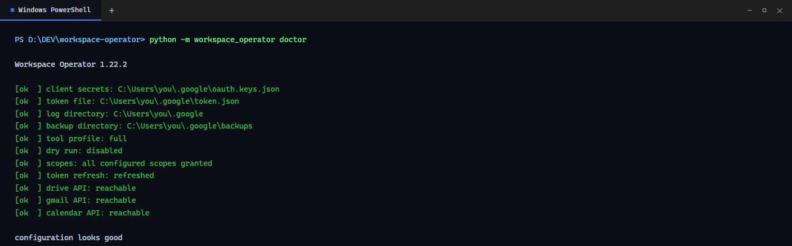

# Настройка Google OAuth

Workspace Operator использует **installed application** flow: вы один раз
нажимаете **Allow** в браузере, токен сохраняется локально, а сервер дальше
обновляет его сам. Сервисный аккаунт и общий сервер не нужны.

Займёт около десяти минут. Согласие выдаётся **одному Google-аккаунту**: для
нескольких аккаунтов запускайте отдельный экземпляр на каждый (см.
[SECURITY.md](SECURITY.md#модели-развёртывания-и-изоляция)). Повторять нужно
только при смене scopes или переезде на новую машину.

## Что понадобится

- Аккаунт Google.
- Проект в Google Cloud (бесплатного уровня достаточно).
- Python 3.10+ с установленным пакетом или Docker-образ.
- Браузер для первой авторизации.

## Два секрета, не перепутайте

| Секрет | Что это | Откуда берётся |
|---|---|---|
| `oauth.keys.json` | Учётные данные OAuth **клиента** (client id + secret) | Google Cloud Console, скачиваются один раз |
| `token.json` | OAuth **токен** с выданными scopes | Создаётся при согласии в браузере |
| `mcp_auth_token` | Локальная bearer-строка MCP, не Google-учётка | Вы придумываете длинную случайную строку |

`token.json` даёт серверу доступ к вашему Google-аккаунту. `mcp_auth_token`
защищает только сам MCP-сервер и используется как `Authorization: Bearer` в
HTTP. Смена `mcp_auth_token` не требует переавторизации в Google, а удаление
`token.json` не меняет `mcp_auth_token`.

## Шаг 1 — Создайте или выберите проект

1. Откройте [Google Cloud Console](https://console.cloud.google.com/).
2. Выберите проект в верхней панели или нажмите **New Project**.
3. Назовите его, например `workspace-operator`, и создайте.

## Шаг 2 — Включите API

**APIs & Services → Library**, включите:

| API | Для чего |
|---|---|
| Google Drive API | файлы, папки, права |
| Google Docs API | документы |
| Google Sheets API | таблицы |
| Gmail API | почта, метки, фильтры |
| Google Calendar API | события |
| Google Apps Script API | проекты и деплои скриптов |
| Google Tasks API | списки задач и задачи |
| Google Forms API | формы и ответы |
| Gmail Postmaster Tools API | доставляемость домена (необязательно) |

Postmaster необязателен и отдаёт данные только для доменов, подтверждённых в
Search Console и добавленных в Postmaster Tools.

> Включить API и выдать OAuth scope — два разных действия. API должен быть
> включён в проекте, а пользователь должен одобрить scope на экране согласия.
> Сервер запрашивает все scopes из `config.yaml`.

## Шаг 3 — Настройте экран согласия

1. **APIs & Services → OAuth consent screen**.
2. Выберите **External**, если используете личный аккаунт Google.
3. Заполните **App name**, **User support email** и **Developer contact email**.
4. Пока приложение в режиме **Testing**, добавьте свой аккаунт в **Test users**.
5. Scopes вручную добавлять не нужно: сервер запросит их из `config.yaml` при
   авторизации.

Публиковать приложение для личного использования не требуется. Предупреждение
«приложение не проверено» в режиме Testing — это нормально.

## Шаг 4 — Создайте OAuth-клиент

1. **APIs & Services → Credentials → Create credentials → OAuth client ID**.
2. Тип приложения: **Desktop app**.
3. Название, например `workspace-operator desktop`.
4. Нажмите **Create**, затем **Download JSON**.

## Шаг 5 — Разложите файлы

Создайте приватный каталог и сохраните скачанный JSON как `oauth.keys.json`:

- Linux/macOS: `~/.google/oauth.keys.json`
- Windows: `C:\Users\<вы>\.google\oauth.keys.json`

`token.json` появится в этом же каталоге после первой авторизации. Ни один из
файлов нельзя коммитить; оба в `.gitignore`.

Пропишите пути в `config.yaml`:

```yaml
client_secrets_file: "/home/you/.google/oauth.keys.json"
token_file: "/home/you/.google/token.json"
backup_dir: "/home/you/.google/backups"
```

Пример для Windows:

```yaml
client_secrets_file: "C:/Users/you/.google/oauth.keys.json"
token_file: "C:/Users/you/.google/token.json"
```

Работают и переменные окружения: `GOOGLE_CLIENT_SECRETS_FILE`,
`GOOGLE_TOKEN_FILE`, `GOOGLE_BACKUP_DIR`, а `MCP_CONFIG_FILE` указывает на YAML.

## Шаг 6 — Авторизуйтесь один раз

### stdio или локальный сервер

```bash
workspace-operator doctor
```

При первом запуске откроется браузер. Войдите, проверьте scopes, нажмите
**Allow**. Токен запишется в `token_file`. Затем `doctor` проверит токен,
выданные scopes и несколько живых API.

Можно просто запустить сервер — тот же сценарий сработает при первом вызове,
которому нужен Google:

```bash
workspace-operator serve
```

### Docker или машина без браузера

Контейнер не может открыть браузер. Авторизуйтесь на машине с браузером:

1. Запустите `workspace-operator doctor` на настольной машине и пройдите согласие.
2. Скопируйте `token.json` рядом с `oauth.keys.json` на сервере.
3. Смонтируйте каталог в контейнер **на запись**, например
   `-v "$HOME/.google:/home/app/.google"`.

Монтирование на запись важно: сервер обновляет токен на месте. Read-only
монтирование сломается, как только истечёт access token.

### Экран «приложение не проверено»

Это ожидаемо для личного приложения в Testing. Нажмите **Advanced → Go to
workspace-operator (unsafe)**, только если этот OAuth-клиент создали вы сами.

## Шаг 7 — Scopes

Стандартная конфигурация запрашивает 13 scopes (Drive, Docs, Sheets,
Gmail, Calendar, Apps Script, Tasks, Forms, Postmaster). Полный список и
read-only варианты — в [SECURITY.md](SECURITY.md).

Чтобы сузить доступ, отредактируйте `scopes:` в `config.yaml`, удалите
`token.json` и снова запустите `workspace-operator doctor`. Doctor сравнит
настроенные и выданные scopes и покажет недостающие, вместо молчаливого 403.

Переавторизация нужна, если вы:

- добавили или убрали scopes;
- обновились на мажорную версию, где появились новые scopes;
- переехали на другую машину или аккаунт Google.

Процедура одна: удалить `token.json`, запустить `workspace-operator doctor`,
подтвердить доступ в браузере.

## Шаг 8 — Проверка

```bash
workspace-operator version
workspace-operator doctor
```

Здоровая конфигурация показывает токен, совпадающие scopes и доступные API.
Если проверка API падает с `403 insufficientPermissions`, токен старее этого
scope: переавторизуйтесь.



*`workspace-operator doctor` после успешной авторизации.*

## Если что-то не работает

| Симптом | Что делать |
|---|---|
| `FileNotFoundError: Client secrets file not found` | Проверьте `client_secrets_file`; путь абсолютный, в Windows — прямые слэши |
| Браузер не открылся, напечатан URL | Откройте URL вручную; на SSH используйте сценарий с настольной машиной |
| `Access blocked: This app's request is invalid` | Не настроен consent screen или аккаунт не добавлен в test users |
| `403 insufficientPermissions` | Токену не хватает scope; удалите `token.json` и переавторизуйтесь |
| `invalid_grant` / токен истёк | Удалите `token.json` и авторизуйтесь заново |
| Docker работал, через час перестал | Каталог Google смонтирован read-only; перемонтируйте на запись |
| Postmaster отдаёт пустой список | Нет подтверждённого домена; добавьте его в Search Console и Postmaster Tools |

Другие случаи: [TROUBLESHOOTING.md](TROUBLESHOOTING.md).

## Безопасность

- Никогда не коммитьте `oauth.keys.json` и `token.json`.
- Токен может всё, что разрешено выданными scopes. Для чтения используйте
  профиль `read-only` и read-only scopes.
- `mcp_auth_token` держите случайным и вне git; это bearer для HTTP.
- Аудит-лог пишет имена инструментов и аргументов, но не значения.
